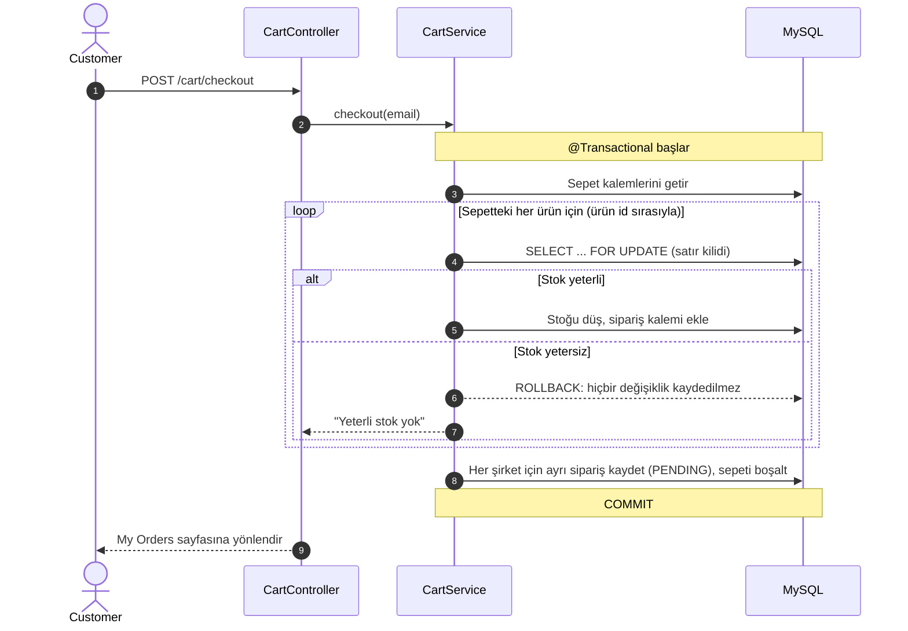
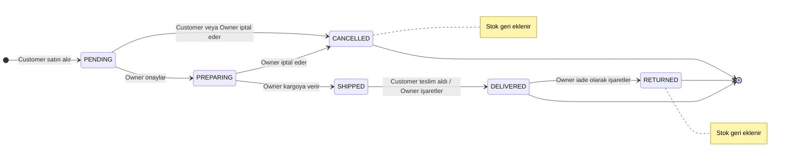
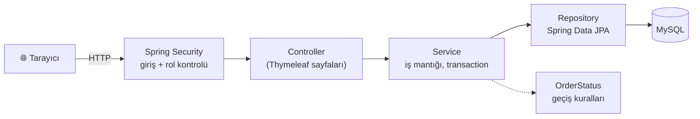
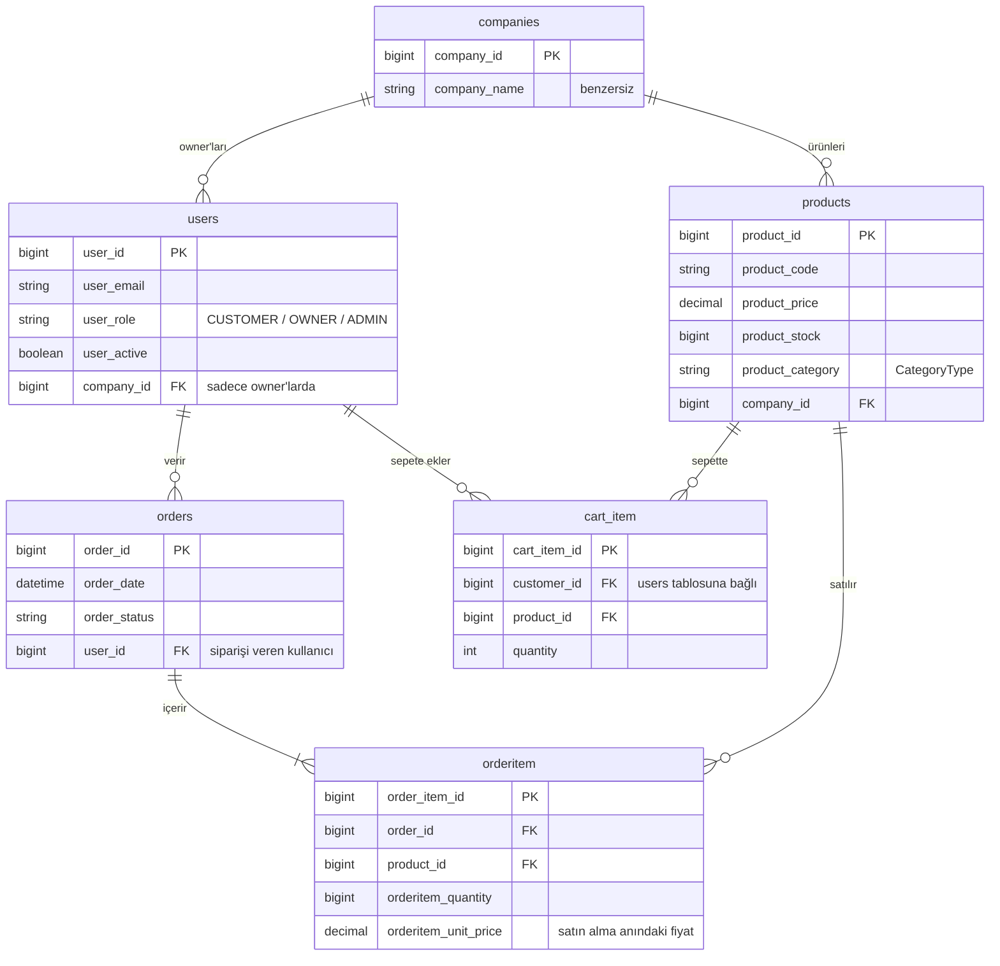

# 📦 Order Management System


Küçük işletmelerin ürünlerini, stoklarını ve siparişlerini tek bir yerden yönetebildiği; müşterilerin ise farklı şirketlerden alışveriş yapıp siparişlerini adım adım takip edebildiği bir web uygulaması.

Sistemde üç rol vardır. Her kullanıcı giriş yaptığında rolüne özel bir ana sayfa ve menü görür.

| Rol | Ne yapar? |
|---|---|
| **Owner** (işletme sahibi) | Şirketinin ürünlerini ekler ve düzenler, stoğu takip eder, siparişleri onaylayıp kargoya kadar ilerletir, müşterilerini ve raporlarını görür. |
| **Customer** (müşteri) | Farklı şirketlerin ürünlerini inceler, sepete ekler, satın alır ve siparişini takip eder. |
| **Admin** (yönetici) | Kullanıcıların rollerini değiştirir, hesapları aktif veya pasif yapar. |

<!--
  EKRAN GÖRÜNTÜLERİ
  1. Görselleri docs/ klasörüne şu adlarla koyun:
     owner-dashboard.png, products.png, order-tracking.png, reports.png, demo.gif
  2. Bu yorum bloğunu silip aşağıdaki bölümü yorumdan çıkarın.
-->
<!--
## 📸 Ekran Görüntüleri


| Owner paneli | Ürün yönetimi |
|---|---|
|  |  |

| Sipariş takibi (Customer) | Raporlar |
|---|---|
|  |  |
-->

## İçindekiler

- [Öne Çıkan Teknik Noktalar](#-öne-çıkan-teknik-noktalar)
- [Sipariş Akışı](#-sipariş-akışı)
- [Özellikler](#-özellikler)
- [Teknolojiler](#️-teknolojiler)
- [Kurulum](#️-kurulum)
- [Proje Yapısı](#️-proje-yapısı)
- [Bilinen Kısıtlar](#️-bilinen-kısıtlar)
- [Yol Haritası](#-yol-haritası)

---

## 💡 Öne Çıkan Teknik Noktalar

- **Tutarlı satın alma:** Sepetten sipariş oluşturma tek bir transaction içinde çalışır. Sepetteki herhangi bir üründe stok yetmezse sipariş oluşturulmaz ve hiçbir stok değişmez.
- **Şirket başına sipariş:** Sepette farklı şirketlerin ürünleri varsa her şirket için ayrı bir sipariş oluşur. Böylece bir owner'ın onay veya iptal işlemi başka bir şirketin siparişini ve stoğunu etkilemez.
- **Eşzamanlılık güvenliği:** Stok güncellenirken ürün satırı kilitlenir (pessimistic lock). Aynı anda gelen siparişler stoğu eksiye düşüremez. Satırlar her zaman ürün id sırasıyla kilitlendiği için eşzamanlı siparişler birbirini kilitleyemez (deadlock olmaz).
- **Durum makinesi tek yerde:** Hangi durumdan hangisine geçilebileceği, hangi durumda iptal yapılabileceği ve stoğun ne zaman geri ekleneceği `OrderStatus` enum'unda tanımlıdır.
- **Veri izolasyonu:** Owner yalnızca kendi şirketinin ürünlerini ve sipariş kalemlerini görür. Customer yalnızca kendi sepetinde ve siparişlerinde işlem yapabilir. Başkasına ait bir kayda erişim denemesi "bulunamadı" olarak döner.
- **Sunucu tarafı raporlama:** Owner için satış, sipariş ve stok raporları; customer için harcama raporu.

### Satın alma (checkout) nasıl çalışır?



---

## 🔄 Sipariş Akışı



| Kural | Açıklama |
|---|---|
| Stok | Satın alındığında ürünler stoktan düşülür; sipariş **iptal** veya **iade** edilirse stok geri eklenir. |
| Customer iptali | Yalnızca *onay bekleyen* (`PENDING`) siparişler iptal edilebilir. |
| Owner iptali | Sipariş kargoya verilene kadar (`PENDING`, `PREPARING`) iptal edilebilir. |
| Teslim | Kargodaki siparişi customer "Teslim aldım" diyerek veya owner "Teslim edildi" olarak işaretleyerek kapatır. |
| İade | Yalnızca teslim edilmiş siparişler iade olarak işaretlenebilir. |
| Takip | Customer, *My Orders* sayfasında her siparişin altında bir takip çubuğu görür: `Order Placed → Preparing → Shipping → Delivered`. |

---

## ✨ Özellikler

| | Owner | Customer | Admin |
|---|:---:|:---:|:---:|
| Kayıt / giriş / çıkış | ✅ | ✅ | ✅ |
| Rolüne özel ana sayfa | ✅ | ✅ | ✅ |
| Özet istatistik paneli | ✅ | — | — |
| Ürün ekleme ve düzenleme (hiyerarşik kategori) | ✅ | — | — |
| Düşük stok uyarısı | ✅ | — | — |
| Ürün listeleme | Kendi şirketi | Tüm şirketler (şirkete göre gruplu) | — |
| Sepet (ekle, artır, azalt, çıkar, satın al) | — | ✅ | — |
| Sipariş listesi | Durum filtresiyle | Kendi siparişleri | — |
| Sipariş durumu güncelleme | ✅ | Teslim aldım | — |
| Sipariş iptali (stok geri eklenir) | ✅ | Onay beklerken | — |
| Sipariş takip çubuğu | — | ✅ | — |
| Müşteriler sayfası | ✅ | — | — |
| Raporlar | Satış, sipariş, stok | Harcama | — |
| Kullanıcı rolü ve aktiflik yönetimi | — | — | ✅ |

### 📊 Raporlar (`/reports`)

<details>
<summary><b>Owner: Satış raporu</b></summary>

- Toplam satış, sipariş sayısı, ortalama sipariş tutarı, satılan ürün adedi
- Onay bekleyen siparişler, açık sipariş tutarı, teslim edilmiş satış, iptal/iade oranı
- Son 6 ayın satış grafiği, duruma ve kategoriye göre dağılım
- En çok satan ürünler, en çok alışveriş yapan müşteriler
</details>

<details>
<summary><b>Owner: Sipariş istatistikleri</b></summary>

- Bugün, son 7 gün ve son 30 gün (önceki dönemle karşılaştırmalı ▲▼)
- Son 14 günün günlük sipariş grafiği, haftanın günlerine göre dağılım
- En yoğun gün ve saat, sipariş başına ürün sayısı, en büyük sipariş, tekrar eden ve yeni müşteriler
</details>

<details>
<summary><b>Owner: Stok raporu</b></summary>

- Ürün sayısı, toplam stok, stok değeri, stokta olmayan ürünler
- Düşük stoklu ürünler ve hiç satılmamış ürünler
</details>

<details>
<summary><b>Customer: Harcama raporu</b></summary>

- Toplam harcama, sipariş sayısı, ortalama sipariş tutarı, alınan ürün adedi
- Son 6 ayın harcama grafiği, sipariş durumları, şirketlere göre harcama, en çok alınan ürünler
</details>

> Tutarlara iptal ve iade edilen siparişler dahil edilmez.

### 🔒 Güvenlik

- Spring Security ile form tabanlı giriş ve CSRF koruması
- Şifreler BCrypt ile hash'lenerek saklanır
- Sayfa ve işlem bazında rol kontrolü: ürün ekleme/düzenleme ve sipariş durumu yalnızca Owner'a, `/admin` yalnızca Admin'e açıktır
- Kayıt formundan yalnızca Owner veya Customer rolü seçilebilir; Admin rolü sadece admin panelinden verilir
- Kayıt formu sunucu tarafında doğrulanır (zorunlu alanlar, geçerli e-posta, en az 8 karakterlik şifre); e-posta veritabanında da benzersizdir
- Sepet ve satın alma yalnızca Customer'a açıktır
- Pasif yapılan hesaplar giriş yapamaz
- Veritabanı bağlantı bilgileri repoda değil, `.gitignore`'daki yerel ayar dosyasında tutulur

---

## 🛠️ Teknolojiler

| Katman | Teknoloji |
|---|---|
| Dil ve framework | Java 17, Spring Boot 4.1 |
| Web | Spring Web MVC, Thymeleaf (sunucu tarafında oluşturulan sayfalar) |
| Güvenlik | Spring Security (form login, rol bazlı yetkilendirme, BCrypt) |
| Veri erişimi | Spring Data JPA / Hibernate, pessimistic lock |
| Veritabanı | MySQL 8 |
| Test | JUnit 5, Mockito, Spring Security Test, H2 (bellekte veritabanı) |
| Diğer | Bean Validation, Lombok, Maven |

---

## ⚙️ Kurulum

**Gereksinimler:** JDK 17+, Maven, MySQL 8+

**1. Projeyi klonlayın**

```bash
git clone https://github.com/Gulfem93/OrderManagementSystem.git
cd OrderManagementSystem
```

**2. Veritabanını oluşturun**

```sql
CREATE DATABASE ordermanagementsystem;
```

Tablolar uygulama ilk açıldığında otomatik oluşturulur (`ddl-auto: update`).

**3. Yerel ayar dosyasını oluşturun**

Uygulama `dev` profiliyle açılır. `src/main/resources/application-dev.yml` dosyasını oluşturup kendi MySQL bilgilerinizi yazın. Bu dosya şifre içerdiği için `.gitignore`'dadır ve GitHub'a gönderilmez.

```yaml
spring:
  datasource:
    url: jdbc:mysql://localhost:3306/ordermanagementsystem
    username: <kullanici_adi>
    password: <sifre>
  jpa:
    hibernate:
      ddl-auto: update

app:
  seed:
    enabled: false
```

**4. Uygulamayı çalıştırın**

```bash
mvn spring-boot:run
```

Tarayıcıda **http://localhost:8080** adresine gidin, bir hesap oluşturun ve giriş yapın.

### 👤 Admin hesabı

Admin rolü kayıt formundan seçilemez. İki yolla admin hesabı oluşturulabilir:

**a) Mevcut bir kullanıcıyı admin yapmak (önerilen).** Önce normal bir hesapla kaydolun, ardından uygulamayı o hesabın e-postasıyla başlatın. Birden fazla adres virgülle ayrılır:

```bash
ADMIN_EMAILS=ornek@mail.com mvn spring-boot:run
```

**b) Açılışta admin hesabı oluşturmak.** `application-dev.yml` içinde `app.seed.enabled: true` yapıldığında uygulama açılışta bir admin hesabı oluşturur (hesap zaten varsa dokunmaz). Şifre koda yazılmaz; `SEED_ADMIN_PASSWORD` ortam değişkeninden (veya `app.seed.admin-password` ayarından) okunur. E-posta `SEED_ADMIN_EMAIL` ile değiştirilebilir. Şifre verilmezse hesap oluşturulmaz. Bu yöntem yalnızca yerel geliştirme içindir.

```bash
SEED_ADMIN_PASSWORD=guclu-bir-sifre mvn spring-boot:run
```

### 🧪 Testler

```bash
mvn test
```

Testler MySQL gerektirmez; `test` profiliyle bellekte çalışan H2 veritabanını kullanır (`src/test/resources/application-test.yml`).

| Test | Neyi doğrular |
|---|---|
| `CartServiceTest` | Checkout stoğu düşer, şirket başına sipariş oluşturur, ürünleri id sırasıyla kilitler, stok yetmezse hiçbir şey kaydetmez |
| `OrderServiceTest` | Durum geçişleri, iptalde stok iadesi, başka şirketin / müşterinin siparişine erişim engeli |
| `UserServiceTest` | Kayıt: şifre hash'leme, owner için şirket oluşturma, admin rolünün seçilememesi, tekrar eden e-posta |
| `OrderStatusTest` | Sipariş durum makinesi kuralları |
| `SecurityAccessTest` | Rol bazlı erişim (sepet, ürün ekleme, admin paneli), CSRF, kayıt formu doğrulaması |

---

## 🗂️ Proje Yapısı

Proje katmanlı mimariyle düzenlenmiştir: istek **controller**'a gelir, iş mantığı **service**'te çalışır, veritabanı işlemleri **repository** üzerinden yapılır.

```
src/main/java/com/ordermanagementsystem
├── dev
│   ├── config/       → Güvenlik, şifreleme, admin hesabı oluşturma
│   ├── controller/   → Sayfa istekleri (Home, Login, Signup, Product, Cart,
│   │                   Orders, Customers, Reports, Admin)
│   ├── service/      → İş mantığı (sepet, sipariş, stok, raporlar)
│   ├── repository/   → Veritabanı erişimi
│   ├── model/        → Veritabanı tabloları (Entity)
│   └── data/         → Formlardan gelen ve sayfalara giden veriler (DTO)
└── enums
    ├── OrderStatus   → Sipariş durumları ve izin verilen geçişler
    ├── CategoryType  → Hiyerarşik ürün kategorileri
    └── UserRole      → Kullanıcı rolleri

src/main/resources
├── templates/        → HTML sayfaları (Thymeleaf)
├── static/css/       → Stil dosyaları
└── application.yml   → Ortak ayarlar (yerel ayarlar application-dev.yml'de)
```

### Katmanlar



### Veritabanı



> Eski veritabanları (ayrı `customers` tablosu, metin şirket adı, iki rol alanı) uygulama açılışında
> `LegacySchemaMigration` ile otomatik olarak yeni modele taşınır.

### Sayfalar

| Adres | Kim görür | Açıklama |
|---|---|---|
| `/signup`, `/login` | Herkes | Kayıt ve giriş |
| `/` | Giriş yapan herkes | Rolüne özel ana sayfa |
| `/products` | Owner / Customer | Ürün yönetimi / alışveriş |
| `/orders` | Owner / Customer | Şirketin siparişleri / sepet ve sipariş geçmişi |
| `/customers` | Owner | Şirketten alışveriş yapan müşteriler |
| `/reports` | Owner / Customer | Satış, sipariş ve stok raporu / harcama raporu |
| `/admin` | Admin | Kullanıcı yönetimi |

---

## ⚠️ Bilinen Kısıtlar

- **Eski çok şirketli siparişler.** Yeni siparişler şirket başına bölünür. Bu değişiklikten önce oluşturulmuş ve birden fazla şirketin ürününü içeren siparişlerde, bir owner durumu değiştirdiğinde siparişin tamamı etkilenir.
- Veritabanı şeması `ddl-auto: update` ve `LegacySchemaMigration` ile yönetilir; Flyway/Liquibase gibi sürümlü bir migration aracı yoktur.
- Arayüz metinleri İngilizcedir.

---

## 🧭 Yol Haritası

**Tamamlananlar**
- [x] Sepetten sipariş oluşturma ve stoktan düşme
- [x] Sipariş durumunu güncelleme ve müşteri tarafında takip
- [x] Sipariş iptali ve iade (stok geri ekleme)
- [x] Müşteriler sayfası
- [x] Raporlar sayfası
- [x] Ürün düzenleme ve kategori seçimi

**Sıradakiler**
- [x] Şirketleri ayrı bir tabloya taşıma, `customers` tablosunu kaldırma, tek rol alanı
- [x] Servis katmanı için birim testleri (sepet, checkout, durum geçişleri) ve güvenlik testleri
- [x] Sepeti şirket başına ayrı siparişlere bölme
- [ ] Docker Compose ile tek komutla kurulum
- [ ] GitHub Actions ile otomatik test
- [ ] Ürün silme / pasife alma
- [ ] Profil ve hesap bilgileri sayfası
- [ ] Ürün arama, kategoriye göre filtreleme ve sayfalama
- [ ] Siparişte teslimat adresi

---

## 👩‍💻 Geliştirici

**Gülfem Işık** · [GitHub](https://github.com/Gulfem93)